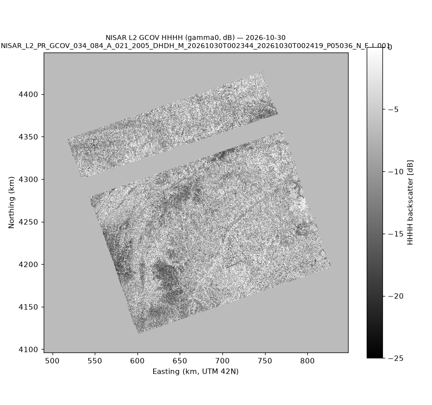
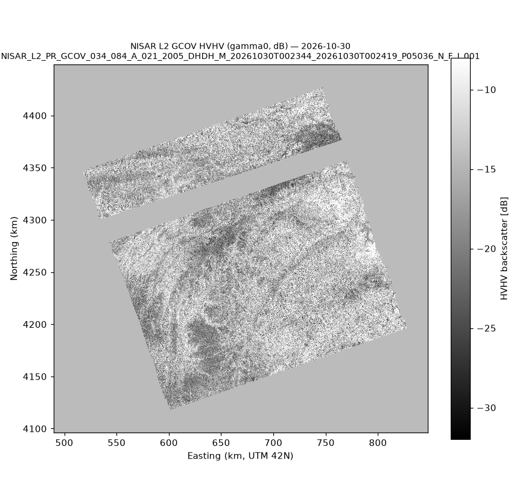
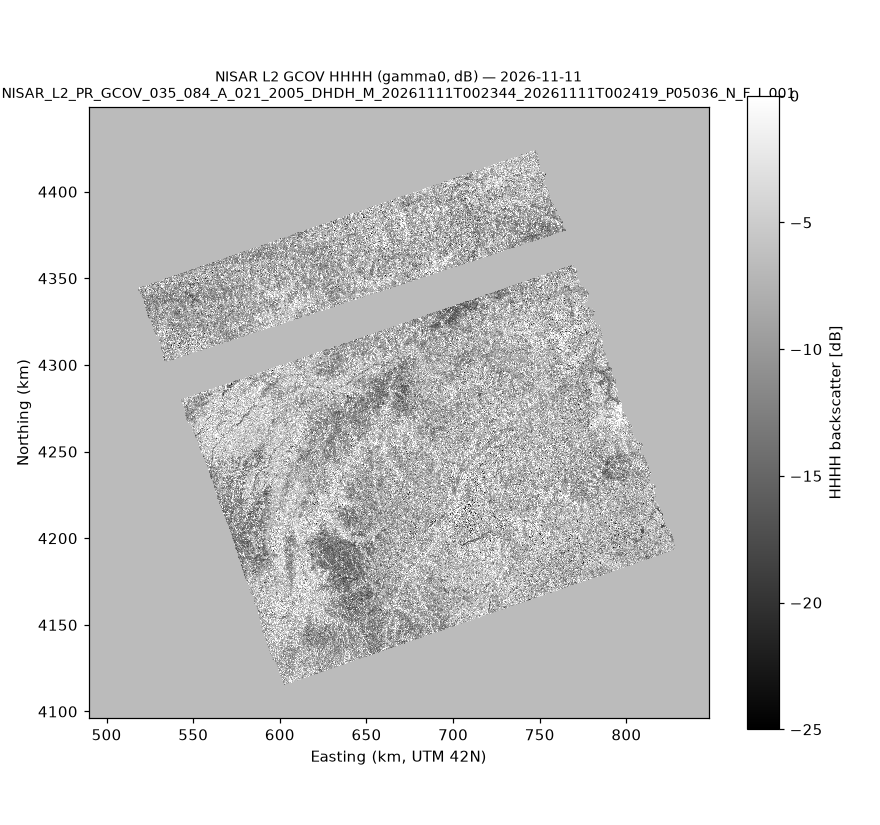
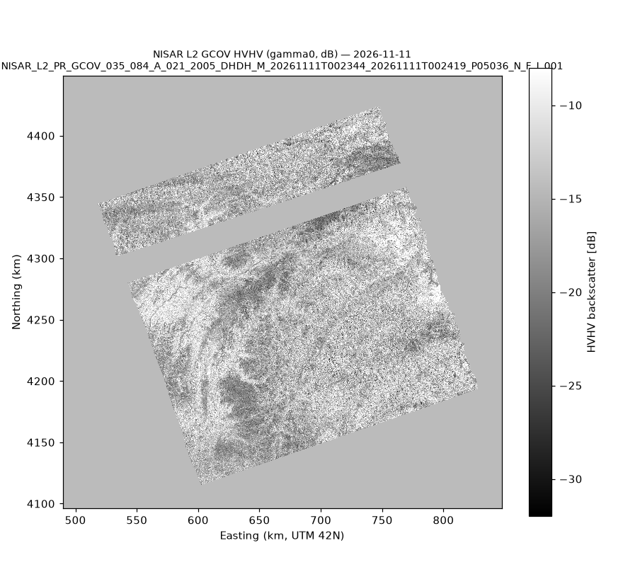
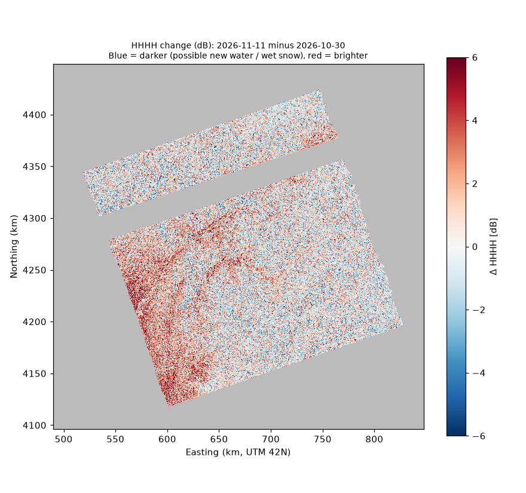

# Phase 1 — NISAR Dataset Verification

**Status:** draft, dataset part (Tasks 1–4 and the data side of Task 6). Task 5 (flood-detection science) is still open for G2.
**Date:** 2026-11-13
**Files checked:** the two `.h5`, `.iso.xml` and `QA_SUMMARY.csv` files from the team's `Nasa.zip`

## Verdict

| Question | Answer | Confidence |
|---|---|---|
| Can the files be opened and read? | **Yes.** Both open with `h5py`; all expected layers are present. | Confirmed |
| Do the radar values look physically reasonable? | **Yes.** HH median ≈ −8 dB, HV median ≈ −15 dB; ~84% of the swath is valid. | Confirmed |
| Can the two dates be compared pixel by pixel? | **Yes — perfectly aligned.** Same grid, same origin, 0.0 px offset. No resampling needed. | Confirmed |
| Does the failed `identification` QA check make the data unusable? | **No evidence it does.** All radiometric and grid checks pass. The exact failing field isn't reported; see § 2. | Likely, not confirmed |
| Do these two images show a flood? | **No.** Both images were taken *before* the reported Nov 12 incident, and there's no water signal at that location. | Confirmed |
| Is this data suitable for Phase 2? | **Yes, as a baseline and a working pipeline. Not yet for a flood claim.** A post-event image is needed. | — |

## 1. HDF5 structure (Task 1)

Both files have identical structure (343 objects). Full listing: run `python scripts/inspect_h5.py <file.h5>`.

### Radar measurements — `/science/LSAR/GCOV/grids/frequencyA/` (20 m)

| Dataset | Shape (rows × cols) | Type | Meaning |
|---|---|---|---|
| `HHHH` | 17640 × 17892 | float32 | HH backscatter, **gamma0, linear power**. Fill = NaN |
| `HVHV` | 17640 × 17892 | float32 | HV (cross-pol) backscatter, gamma0, linear power. Fill = NaN |
| `mask` | 17640 × 17892 | uint8 | 255 = outside swath; 0 = partially focused (not valid); 1..n = valid sub-swath number |
| `inputDataExceptionMask` | 17640 × 17892 | uint16 | Bit flags for raw-data anomalies and per-polarization validity |
| `numberOfLooks` | 17640 × 17892 | float32 | Radar looks averaged per pixel (speckle level) |
| `rtcGammaToSigmaFactor` | 17640 × 17892 | float32 | Multiply by this to convert gamma0 → sigma0 |
| `xCoordinates`, `yCoordinates` | 17892, 17640 | float64 | Pixel-centre UTM coordinates (m) |
| `xCoordinateSpacing`, `yCoordinateSpacing` | scalar | float64 | 20.0 / −20.0 m |
| `projection` | scalar | uint32 | EPSG 32642 (UTM zone 42N) |
| `listOfPolarizations` / `listOfCovarianceTerms` | 2 | string | `HH, HV` / `HHHH, HVHV` |

`frequencyB/` has the same layers at **80 m** (4410 × 4473). It's the 5 MHz side-band, so it's coarser. We use frequency A.

**There is no VV or HH–HV cross term.** This is dual-pol (DH) data, and `isFullCovariance = False`.

### Metadata and quality — `/science/LSAR/GCOV/metadata/`

| Group | Contents | Useful for us? |
|---|---|---|
| `processingInformation/parameters` | Processing flags (noise, RTC, shadow, RFI…) | Yes, see § 2.2 |
| `calibrationInformation/frequencyA/noiseEquivalentBackscatter/{HH,HV}` | Noise floor, coarse 354 × 359 grid | Yes, for the HV noise limit |
| `radarGrid/` | Incidence angle, look vectors, slant range (3-D cube 21 × 718 × 728) | Yes, for the shadow/layover proxy |
| `ceosAnalysisReadyData/` | CEOS-ARD type = Normalised Radar Backscatter; dB formula `10*log10(<GCOV_TERM>)` | Confirms the dB conversion |
| `orbit/`, `attitude/` | Orbit state vectors (MOE = medium precision), attitude | No |
| `sourceData/` | Info on the input L1 RSLC product | No |

### Identification — `/science/LSAR/identification/` (key values)

| Field | Oct 30 | Nov 11 |
|---|---|---|
| granuleId | `…_034_084_A_021_…_20261030T002344…` | `…_035_084_A_021_…_20261111T002344…` |
| cycle / track / frame | 34 / 84 / 21 | 35 / 84 / 21 |
| orbit pass / look | Ascending / Left | Ascending / Left |
| zeroDopplerStartTime (UTC) | 2026-10-30 00:23:44 | 2026-11-11 00:23:44 |
| productVersion / spec | 1.0.20 / 1.6.0 | 1.0.20 / 1.6.0 |
| compositeReleaseId | P05036 | P05036 |
| processingDateTime | 2026-11-08 09:13 | 2026-11-13 11:28 |
| listOfObservationModes | `(NOT SPECIFIED)` | `(NOT SPECIFIED)` |
| isUrgentObservation / isJointObservation / isMixedMode | True / True / True | True / True / True |

**Same track, frame, look direction and processing version, exactly 12 days apart.** This is the ideal repeat-pass pair for change detection.

## 2. Quality assessment (Task 2)

### 2.1 The `identification` QA failure

**Confirmed:**
- Both QA CSVs report `Passes all identification group checks? FAIL` with **no further detail**. The `Threshold`, `Actual` and `Notes` columns are empty.
- Every other check passes in both files: file opens, coordinate grids are valid, calibration LUTs are valid, the NaN/Inf/fill fraction is under threshold for all four backscatter layers, and QA ran without exceptions.
- The identification values that matter for our analysis are present and consistent between the two files: track, frame, orbit direction, look direction, times and product version.

**Likely cause (assumption, not verified):** `listOfObservationModes = "(NOT SPECIFIED)"` is a placeholder, not a real value. That makes it the most likely field to fail a metadata validity check. The flags `isUrgentObservation`, `isJointObservation` and `isMixedMode` are all True, which is also unusual and may trip consistency checks.

**Impact:** the identification group is descriptive metadata. It has no effect on the backscatter values, the grid or the calibration, and all of those checks pass. **We consider the data usable.**

**To confirm the cause:** download the full QA output for these granules from ASF (QA log / `STATS.h5`), or run NASA's QA tool [`nisarqa`](https://github.com/isce-framework/nisarqa) locally. The latter is a new dependency, so ask first.

### 2.2 Processing flags and what they mean for us

| Flag | Value | Meaning | Limitation for flood work |
|---|---|---|---|
| `radiometricTerrainCorrectionApplied` | True | Values are **gamma0**, corrected for terrain slope brightness | Good: slopes facing toward or away from the radar are comparable. |
| `noiseCorrectionApplied` | **False** | Thermal noise wasn't subtracted | Very dark surfaces such as water and smooth ice sit near the noise floor, especially in **HV**. HV can't reliably tell water from noise, so **use HH as the main water channel.** |
| `shadowMaskingApplied` | **False** | Radar shadow and layover pixels are **not** masked | **Major for a mountain scene.** Shadow is dark, just like water, so it must be masked before detection. The mask is in the separate *static layers* product (URL in `staticLayersDataAccess`), or can be approximated from DEM + incidence angle. |
| `rfiMitigationApplied` | False | Radio interference not removed | Possible bright stripes; none obvious in the previews. |
| `faradayRotationApplied` | False | No ionospheric polarization correction | Minor at these latitudes. |
| `validSamplesSubSwathMaskingApplied` | False | Partially focused pixels are not set to NaN | **We must apply `mask` ourselves** (drop 0 and 255). |
| orbit type | MOE | Medium-precision orbit, not final | Geolocation accuracy fields are NaN, so absolute accuracy is not characterized. Relative alignment between the two dates is still exact (same grid). |

### 2.3 Data-quality numbers (from previews read at every 10th pixel)

| | Oct 30 | Nov 11 |
|---|---|---|
| Swath area as % of grid | 50.1% | 50.1% |
| Partially focused (mask = 0), % of swath | **16.0%** | **16.0%** |
| NaN/Inf in swath | 0.59% | 0.59% |
| Valid pixels, % of swath | 84.0% | 84.0% |
| HH: 2nd pct / median / 98th pct (dB) | −16.3 / −8.1 / +2.5 | −15.4 / −7.7 / +2.9 |
| HV: 2nd pct / median / 98th pct (dB) | −23.6 / −15.2 / −4.5 | −22.9 / −14.8 / −4.4 |

The partially focused pixels form a **band roughly 20–25 km wide across the whole swath, in the same place on both dates**. This is a systematic acquisition feature (possibly linked to `isMixedMode`), not a random defect. Nothing can be analysed inside that band.

## 3. Visualizations (Task 3)

dB = `10*log10(value)`, per the product's own `outputBackscatterDecibelConversionFormula`. Grey background = outside swath or invalid.

| | HHHH | HVHV |
|---|---|---|
| **Oct 30** |  |  |
| **Nov 11** |  |  |

### Change preview: HH, Nov 11 minus Oct 30



| Metric | Value |
|---|---|
| Mean change | +0.43 dB |
| Std. dev. | 2.43 dB |
| Pixels darker by > 3 dB | 6.5% |
| Pixels brighter by > 3 dB | 13.1% |

**What we see (observation):** broad **brightening** of +3 to +6 dB across the south-west of the scene (lower elevations), with scattered speckle elsewhere. There are no large, coherent dark patches.

**Possible explanation (hypothesis, not verified):** wetter soil after rain raises radar backscatter. Tajikistan's weather service (Hydromet) warned of mudslides and rising rivers for **Nov 4–6**, between our two dates. This is **not** a flood signal: open flood water would appear *darker*, not brighter.

## 4. Spatial alignment (Task 4)

| Check | Oct 30 | Nov 11 | Same? |
|---|---|---|---|
| CRS | EPSG:32642 | EPSG:32642 | ✅ |
| Pixel spacing | 20 m × −20 m | 20 m × −20 m | ✅ |
| Shape (rows × cols) | 17640 × 17892 | 17640 × 17892 | ✅ |
| Grid origin offset | — | 0.0 px in x, 0.0 px in y | ✅ |
| Processing grid (run config) | top-left 489600 E / 4448880 N | identical | ✅ |
| Track / frame / look | 84 / 21 / Left, Ascending | identical | ✅ |
| Swath footprint | 50.14% of grid | 50.13% of grid | ≈ (slightly different swath edges) |
| Partially focused band | same location | same location | ✅ |

**Conclusion: perfectly aligned.** Both products are geocoded onto the same fixed NISAR grid for track 84, frame 21, so array index `[row, col]` is the same ground location in both files. **No reprojection or resampling is needed.** Only the validity masks differ slightly at the swath edges. Combine them with AND before comparing.

Note: the bounding coordinates in the original task brief differ by about 0.01° between dates. Those come from the swath footprint (`boundingPolygon`), not the pixel grid, which is identical.

## 5. Event and temporal coverage (Task 6, data side)

```
2026-10-30  ●  NISAR acquisition (cycle 34)               ← have it
2026-11-04  ┐
2026-11-06  ┘  Hydromet mudslide warning, rising Obikhingob & Vakhsh rivers
2026-11-11  ●  NISAR acquisition (cycle 35)               ← have it
2026-11-12  ✱  Reported incident, 38.9°N 71.3°E (UNVERIFIED)
2026-11-14/15  Hackathon
2026-11-23  ○  Next NISAR pass, same track/frame (cycle 36) — expected, 12-day repeat
```

| Question | Finding | Status |
|---|---|---|
| Is the reported Nov 12 incident independently verified? | No news or agency report found of a flood on Nov 12. Hydromet warnings exist only for Nov 4–6. | **Not verified** |
| Is 38.9°N 71.3°E inside our coverage? | Yes. UTM 699.45 km E / 4308.19 km N → pixel row 7034, col 10492, inside a valid sub-swath (`mask = 1`). | Confirmed |
| Is there a NISAR image after the incident? | Not yet. Next same-geometry pass is about **Nov 23**, after the hackathon, and processing adds a few days. | Confirmed (repeat cycle), date expected |
| What do our images show at that point? | 10 × 10 km box: median change −0.04 dB, 0.2% dark pixels on both dates. **No water signal**, as expected for pre-event images. | Confirmed |
| Are the two images useful? | Yes: a **12-day pre-event baseline** showing how much the surface changes with no flood, which gives the false-alarm rate. | — |

**Supporting evidence options:**
- **Sentinel-1 (C-band)**, about 6–12 day revisit, available on the same ASF site.
- **Sentinel-2 optical**, but November cloud and snow are likely.

## 6. Issues found in the delivered files

1. **The `.h5` files are in swapped folders in `Nasa.zip`.** The Oct 30 `.h5` is in `nov11/` and the Nov 11 `.h5` is in `oct30/`. The XML and CSV files are in the correct folders. Always identify files by the date in the **file name**, not the folder.
2. The task brief didn't list Oct 30's acquisition time. It's 00:23:44–00:24:19 UTC, the same as Nov 11.

## 7. What we still need

| Need | Why | Owner |
|---|---|---|
| Shadow / layover mask (NISAR static layers, or computed from DEM) | Shadow looks like water in mountains | AI1 + G1 |
| Full QA log for both granules | Confirm the identification failure cause | G1 |
| A post-event image: NISAR around Nov 23, or Sentinel-1 after Nov 12 | Without it, no flood can be detected | G1 |
| Independent confirmation of the Nov 12 incident | Don't build the story on an unverified event | G1 + G2 |
| Reference water map (e.g., JRC Global Surface Water) | Separate permanent water from new water, and evaluate accuracy | G1 |
| A demo-safe event with a known flood (e.g., Assam, July 2026) | Fallback if no post-event Tajikistan data exists in time | Team decision |

## 8. How to reproduce

```bash
python scripts/inspect_h5.py <file.h5>                                   # full structure
python scripts/inspect_h5.py <file.h5> --values --group /science/LSAR/identification
python scripts/phase1_facts.py <oct30.h5> <nov11.h5>                     # alignment + metadata diff → outputs/phase1/facts.json
python scripts/phase1_previews.py <oct30.h5> <nov11.h5> --step 10        # previews + stats → outputs/phase1/
```

All scripts open the `.h5` files read-only. Tools: Python 3.11, h5py 3.16, NumPy 2.4, Matplotlib 3.11.
